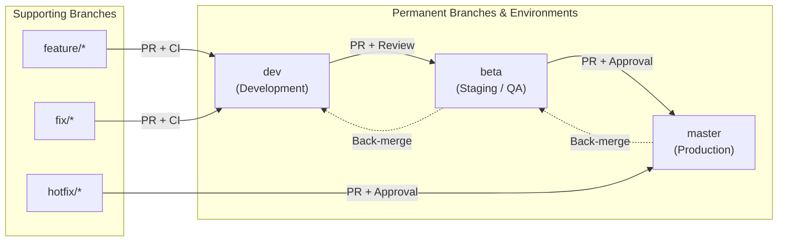

# DevOps & Deployment Guide — alamir-tech

This comprehensive guide outlines the Git branching strategy, environment separation, automated CI/CD pipelines, release management, and database migration safety for the **alamir-tech** Next.js project.

---

## 1. Git Branch Architecture

The project maintains **three permanent branches** corresponding to three isolated environments:



### Permanent Branches
- **`dev`** — Active integration branch. Deploys to Development (`dev.alamirtech.com`).
- **`beta`** — Pre-production staging branch. Deploys to Beta / Staging (`beta.alamirtech.com`) for QA, user acceptance testing (UAT), and regression testing.
- **`master`** — Production branch. Deploys strictly verified, approved releases to Production (`alamirtech.com`). Uses Git tags (e.g. `v1.0.0`).

### Supporting Temporary Branches
- **`feature/<name>`** — New features branched from `dev`. Merges back into `dev`.
- **`fix/<name>`** — Non-urgent bug fixes branched from `dev`. Merges back into `dev`.
- **`hotfix/<name>`** — Urgent production fixes branched from `master`. Merges into `master` and back-propagated to `beta` and `dev`.
- **`release/<version>`** — Optional release stabilization branches created from `dev`.

---

## 2. Developer Workflow: Creating Feature Branches

1. Synchronize local `dev` branch with the remote repository:
   ```bash
   git checkout dev
   git pull origin dev
   ```

2. Create and switch to your feature branch:
   ```bash
   git checkout -b feature/user-profile-page
   ```

3. Work on changes locally and test:
   ```bash
   npm run lint
   npm run build
   ```

4. Commit changes following conventional commit syntax:
   ```bash
   git add .
   git commit -m "feat(profile): implement responsive user profile screen"
   ```

5. Push feature branch to GitHub:
   ```bash
   git push -u origin feature/user-profile-page
   ```

---

## 3. Opening & Merging Pull Requests

1. Navigate to GitHub and open a Pull Request:
   - **Base branch**: `dev`
   - **Head branch**: `feature/user-profile-page`
2. Complete the Pull Request template checklist (`.github/pull_request_template.md`).
3. GitHub Actions triggers `.github/workflows/pull-request-checks.yml`:
   - Runs linting (`npm run lint`).
   - Runs test suite (`npm test --if-present`).
   - Validates build output (`npm run build`).
4. Ensure at least one code review approval is obtained.
5. Merge using **Squash and Merge** (recommended for clean feature history).

---

## 4. Code Promotion: Moving from `dev` to `beta` (Staging)

Once features are tested and ready for QA testing:

1. Open a Pull Request from `dev` into `beta`:
   - **Base branch**: `beta`
   - **Head branch**: `dev`
2. The PR verification workflow verifies that no regressions exist.
3. Once merged into `beta`, GitHub Actions automatically triggers:
   - `.github/workflows/beta-ci-cd.yml`
   - Builds staging artifact with staging environment configuration.
   - Deploys automatically to Staging (`beta.alamirtech.com`).
   - Executes endpoint smoke checks.

---

## 5. Production Approval: Moving from `beta` to `master`

Production deployments must always pass through staging first.

1. Open a Pull Request from `beta` into `master`:
   - **Base branch**: `master`
   - **Head branch**: `beta`
2. Review QA sign-off and verify all checklist items.
3. Merge the Pull Request into `master`.
4. GitHub Actions triggers `.github/workflows/production-ci-cd.yml`.
5. Because the workflow targets GitHub Environment `production`, any configured **Required Reviewers** must approve the deployment in the GitHub Actions UI before the deploy job executes.
6. Once approved, the production artifact builds, deploys to `alamirtech.com`, and performs live health checks.

---

## 6. How Automated Deployment Works

Workflows are located in `.github/workflows/`:

| Workflow File | Trigger Branch | Target Environment | Deployment Action |
|---|---|---|---|
| `dev-ci-cd.yml` | `push` to `dev` | `development` | Deploys dev preview / webhook |
| `beta-ci-cd.yml` | `push` to `beta` | `staging` | Deploys staging preview / smoke check |
| `production-ci-cd.yml` | `push` to `master`, `v*.*.*` | `production` | Production deployment + health check |
| `pull-request-checks.yml` | PR to `dev`, `beta`, `master` | N/A (Ephemeral check) | Lints, builds, verifies branch target |

Each deployment job checks for configured provider secrets (e.g., `VERCEL_TOKEN`, `VERCEL_ORG_ID`, or webhook URLs). If no secrets are yet provided in your repository settings, the workflow builds and validates the code cleanly while logging clear setup instructions.

---

## 7. Configuring GitHub Actions Secrets & Environments

To isolate environments cleanly, use **GitHub Environments**:

1. Go to your GitHub repository: **Settings → Environments**.
2. Create three environments:
   - `development`
   - `staging`
   - `production`
3. In each environment, add the appropriate secrets and variables:

### Environment Secrets Matrix

| Secret Name | Development | Staging | Production | Description |
|---|---|---|---|---|
| `NEXT_PUBLIC_SUPABASE_URL` | Dev project URL | Staging project URL | Production project URL | Supabase API endpoint |
| `NEXT_PUBLIC_SUPABASE_ANON_KEY` | Dev anon key | Staging anon key | Production anon key | Public browser key |
| `SUPABASE_SERVICE_ROLE_KEY` | Dev service key | Staging service key | Production service key | Backend-only key (Never expose in frontend!) |
| `DATABASE_URL` | Dev DB connection | Staging DB connection | Production DB connection | Server-side Postgres pooler |
| `AUTH_SECRET` | Dev secret (32+ char) | Staging secret (32+ char) | High-entropy production secret | Session signing token |
| `VERCEL_TOKEN` *(Optional)* | Vercel Token | Vercel Token | Vercel Token | Vercel CLI deploy token |
| `VERCEL_ORG_ID` *(Optional)* | Vercel Org ID | Vercel Org ID | Vercel Org ID | Vercel Team/Org ID |

### Environment Variables Matrix (Vars)

| Variable Name | Development | Staging | Production |
|---|---|---|---|
| `NEXT_PUBLIC_APP_URL` | `https://dev.alamirtech.com` | `https://beta.alamirtech.com` | `https://alamirtech.com` |
| `NEXT_PUBLIC_API_URL` | `https://dev-api.alamirtech.com/api` | `https://beta-api.alamirtech.com/api` | `https://api.alamirtech.com/api` |

---

## 8. Environment Variable Separation Locally

Four template files exist in the repository root:
- `.env.example` — General template.
- `.env.development.example` — Development defaults.
- `.env.staging.example` — Staging defaults.
- `.env.production.example` — Production guide and strict rules.

### Local Setup
```bash
# For local development
cp .env.development.example .env.local
```
> **Security Rule**: `.gitignore` strictly blocks all `.env*` files except `.env*.example`. Never commit actual API keys, private passwords, or `.env.local` to Git!

---

## 9. Troubleshooting Failed Deployments

### Common Failures & Solutions

1. **Linting Failure (`npm run lint`)**
   - Run `npm run lint` locally.
   - Inspect reported ESLint errors and run auto-fix where applicable:
     ```bash
     npx eslint . --fix
     ```

2. **Font Fetch / Google Fonts Error Offline**
   - Turbopack downloads Google Fonts at build time. In local offline development, self-host fonts with `next/font/local` or ensure network connectivity. In GitHub Actions runners, internet access is enabled by default.

3. **Missing Environment Secrets in CI**
   - Check **Settings → Environments → [environment] → Environment Secrets**.
   - Ensure the secret names match exactly.

4. **Build Memory Limits**
   - If large builds exceed runner memory, add `--max-old-space-size=4096` to the build step in the workflow.

---

## 10. Production Rollback Procedures

If a critical production defect is detected post-deployment:

### Immediate Application Rollback (Zero Data Loss)
1. **Hosting Provider Instant Rollback**:
   - If using Vercel or cloud containers: Roll back instantly in the hosting dashboard to the previous deployment artifact. This takes under 30 seconds.
2. **Git Rollback via Revert**:
   ```bash
   git checkout master
   git pull origin master
   # Revert the faulty merge commit
   git revert -m 1 <MERGE_COMMIT_HASH>
   git push origin master
   ```
   The `production-ci-cd.yml` workflow will automatically trigger and deploy the previous stable state.
3. **Never overwrite production database tables or restore full database snapshots automatically during an application rollback**, as this would erase valid customer transactions created since the release!

---

## 11. Handling Urgent Hotfixes

When a critical production bug must be patched immediately:

1. **Branch off `master` directly**:
   ```bash
   git checkout master
   git pull origin master
   git checkout -b hotfix/critical-auth-bypass
   ```

2. **Implement fix & verify locally**:
   ```bash
   npm run lint
   npm run build
   ```

3. **Open Pull Request directly into `master`**:
   - Tag the PR with `[HOTFIX]`.
   - Require fast-track approval from authorized lead.

4. **Deploy & Tag**:
   Once merged into `master`, tag the patch release:
   ```bash
   git checkout master
   git pull origin master
   git tag -a v1.0.1 -m "Hotfix v1.0.1: critical auth patch"
   git push origin v1.0.1
   ```

5. **Crucial Step: Back-merge hotfix into `beta` and `dev`**:
   ```bash
   # Sync to beta
   git checkout beta
   git pull origin beta
   git merge master
   git push origin beta

   # Sync to dev
   git checkout dev
   git pull origin dev
   git merge beta
   git push origin dev
   ```

---

## 12. Database Migration Safety (Supabase / PostgreSQL)

If database services are integrated:

1. **Maintain Separate Databases**:
   - Development Supabase project for `dev`.
   - Staging Supabase project for `beta`.
   - Production Supabase project for `master`.

2. **Strict Migration Rules**:
   - **Never run destructive migrations** (e.g. `DROP COLUMN`, `DROP TABLE`, `TRUNCATE`).
   - Use the **Expand and Contract pattern**:
     - *Phase 1 (Expand)*: Add new columns as nullable or with defaults. Deploy code that writes to both old and new columns.
     - *Phase 2 (Migrate data)*: Backfill historical data in background.
     - *Phase 3 (Contract)*: Remove reliance on old columns. Deprecate and remove old columns only after all environments are stable.
   - **Row Level Security (RLS)**: Always verify that RLS is enabled on all tables with explicit `SELECT`, `INSERT`, `UPDATE`, and `DELETE` policies.
   - **Backups**: Confirm that Supabase Point-in-Time Recovery (PITR) or automated daily backups are active before running schema changes in production.

---

## 13. GitHub Branch Protection Setup (Manual Action Required)

Since branch protection rules require repository administrator permissions on GitHub, configure the following in **GitHub Repository Settings → Branches → Branch protection rules**:

### For `dev`:
- Branch name pattern: `dev`
- [x] Require a pull request before merging
- [x] Require status checks to pass before merging:
  - Check: `pr-checks`
- [x] Do not allow bypassing the above settings
- [x] Prevent force pushes
- [x] Prevent deletions

### For `beta`:
- Branch name pattern: `beta`
- [x] Require a pull request before merging
- [x] Require approvals: at least `1` approval
- [x] Require status checks to pass before merging:
  - Check: `pr-checks`
- [x] Prevent force pushes
- [x] Prevent deletions

### For `master`:
- Branch name pattern: `master`
- [x] Require a pull request before merging
- [x] Require approvals: at least `1` or `2` approvals from authorized team leads
- [x] Require status checks to pass before merging:
  - Check: `pr-checks`
- [x] Require conversation resolution before merging
- [x] Require signed commits (recommended)
- [x] Prevent force pushes
- [x] Prevent deletions
